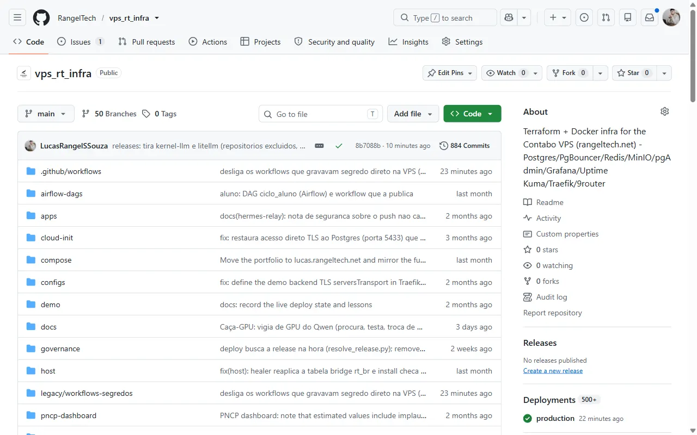

<!-- readme-padrao -->
# Infraestrutura da VPS (vps_rt_infra)

> Infraestrutura da VPS principal (Contabo): Traefik, Postgres, compose dos serviços, DNS (Terraform), backup, caça-GPU, registro único de produtos e o **único caminho de deploy** de todos os serviços (busca a release na hora, gera os `.env` do Infisical, healthcheck e rollback).



## O que é
Infraestrutura da VPS principal (Contabo): Traefik, Postgres, compose dos serviços, DNS (Terraform), backup, caça-GPU, registro único de produtos e o **único caminho de deploy** de todos os serviços (busca a release na hora, gera os `.env` do Infisical, healthcheck e rollback).

Estado: **no ar**.

## Onde está no ar
- Sem endereço público próprio.

## Onde faz o deploy
É o próprio caminho de deploy: `gh workflow run deploy.yml -f service=<servico>` (ver `releases/sources.json` e `registro/produtos.yml`). Mudanças de infraestrutura (stacks, Traefik, DNS) entram por este repositório, nunca à mão na VPS.

## Como funciona por dentro
Resumo acima; os detalhes estão nas notas técnicas (README anterior) abaixo e na spec 57.

## Segredos
Nenhum valor de segredo fica neste repositório. Os segredos dos serviços ficam no Infisical (mapa em `vps_rt_infra/scripts/infisical/mapa_envs.json`) e chegam à VPS gerados no deploy.

## Rodar e testar localmente
Ver as notas técnicas abaixo (cada repositório tem o seu jeito); os testes de QA em produção são por cliques reais, com evidência em `new_ragente/qa/evidencias`.

## Links
- Repositório: https://github.com/RangelTech/vps_rt_infra
- Painel único: https://painel.rangeltech.net
- Spec de organização geral: `new_ragente/specs/57_ORGANIZACAO_GERAL_PRODUTOS_E_PAINEL.md`


<!-- repos:inicio -->
## Repositórios da organização

Gerado por `scripts/readme/lista_mestre.py` (não editar à mão). Todo repositório tem README no padrão da casa (spec 57 §3.2), conferido no CI pelo `scripts/readme/conferir_readme.py`. Capital Certo fica fora.

| Repositório | O que é | Estado | No ar | Deploy (`service=`) |
|---|---|---|---|---|
| [agente-grupos](https://github.com/RangelTech/agente-grupos) (privado) | SaaS multitenant que liga o checkout (webhook de venda da Kiwify, Hotmart e outras) ao grupo de WhatsApp: decide o direito de acesso e inclu | ver README | - | - |
| [ai_aluno](https://github.com/RangelTech/ai_aluno) | Área do aluno da mentoria de Lucas Rangel: cursos, primeiro acesso, ciclo de vida (recuperação de carrinho e downsell) e webhook da Cakto. | ver README | - | - |
| [ai_metricas](https://github.com/RangelTech/ai_metricas) | Umami autogerenciado com as métricas de visita dos sites da Rangel Tech. | ver README | - | - |
| [ai_site](https://github.com/RangelTech/ai_site) | Site de venda da mentoria de Lucas Rangel (planos e checkout da Cakto). | ver README | - | - |
| [animaai](https://github.com/RangelTech/animaai) | Escreve uma ideia e recebe uma animação curta viral: roteiro cena a cena, imagens no estilo escolhido, narração, legenda e o @ da pessoa. | no ar | anima-ai.rangeltech.net | `animaai` |
| [arenabruta](https://github.com/RangelTech/arenabruta) | Arena Bruta (arena.rangeltech.net): duelos 1x1 de habilidade com tema agro valendo dinheiro — carteira com razão de partidas dobradas, Arena | no ar | arena.rangeltech.net | `arenabruta` |
| [astralai](https://github.com/RangelTech/astralai) | Guia espiritual por chat. | no ar | astral-ai.rangeltech.net, astral.rangeltech.net | `astralai` |
| [atendeai](https://github.com/RangelTech/atendeai) | Atende AI (atende-whats/insta/tiktok/face) e Fala Fael: atendimento com IA nas redes do cliente pelo gateway de canais, com regras (skill) d | no ar | atende-ai.rangeltech.net, atende-face.rangeltech.net, atende-insta.rangeltech.net | `atendeai` |
| [autoai](https://github.com/RangelTech/autoai) (privado) | Sistema de oficina mecânica (base Torqvoice, Postgres, multi-empresa). | em teste | autoai.rangeltech.net | `autoai` |
| [boateazul](https://github.com/RangelTech/boateazul) | Boate Azul (azul.rangeltech.net): IA de desejo e intimidade para casais +18 — conversa privada de cada um, match bilateral de afinidades (Nú | no ar | azul.rangeltech.net | `boateazul` |
| [casaai](https://github.com/RangelTech/casaai) | O corretor sobe o vídeo do imóvel e recebe um site cinematográfico: o vídeo vira rolagem quadro a quadro, textos de venda pela IA, botão de  | no ar | casa-ai.rangeltech.net, casa.rangeltech.net | `casaai` |
| [cortai](https://github.com/RangelTech/cortai) | Cola o link de um vídeo longo (YouTube, Instagram, TikTok) e recebe os cortes virais prontos: vertical, legenda grande, gancho e relatório d | no ar | cortai.rangeltech.net | `cortai` |
| [luar_ai_gateway](https://github.com/RangelTech/luar_ai_gateway) | Gateway de LLM por cliente do LUAR (chaves, cotas e rotas de modelos, inclusive voz). | ver README | - | - |
| [luar_chatwoot](https://github.com/RangelTech/luar_chatwoot) | Telas de atendimento, Kanban e canais do LUAR, sobre o Chatwoot, mais a ponte (bridge) com o motor de IA. | em preparo | bridge.rangeltech.net, chat.rangeltech.net, conector.rangeltech.net | `chatwoot-rails` |
| [luar_conector](https://github.com/RangelTech/luar_conector) | Hub de conectores do LUAR (integrações externas dos clientes). | ver README | - | - |
| [luar_docs](https://github.com/RangelTech/luar_docs) (privado) | Specs e documentação do LUAR. | ver README | - | - |
| [luar_engine](https://github.com/RangelTech/luar_engine) | Motor de IA do LUAR (agentes, templates, ferramentas) e o serviço de transcrição Whisper. | ver README | - | - |
| [luar_harness](https://github.com/RangelTech/luar_harness) | Execução dos agentes por skills (kernel-harness) e os trabalhadores Hermes (rt-hermes) usados pelo LUAR e pela IA dos produtos. | ver README | - | - |
| [luar_site](https://github.com/RangelTech/luar_site) | Site institucional do LUAR. | ver README | - | - |
| [luar_workspaces](https://github.com/RangelTech/luar_workspaces) | Gerenciador de ambientes por empresa do LUAR (runtime-manager, borda, workspace e executor). | ver README | - | - |
| [perfil-navegador](https://github.com/RangelTech/perfil-navegador) | Serviço de perfis de navegador usados pelos produtos para logar nas redes sociais (pelo proxy de São Paulo). | ver README | - | - |
| [perfilai](https://github.com/RangelTech/perfilai) | Perfilaí e suíte de perfil (insta-ai, face-ai, tittok-ai, linkdn-ai): plano de Instagram/redes com IA a partir do @, objetivo e prints (raio | no ar | face-ai.rangeltech.net, insta-ai.rangeltech.net, linkdn-ai.rangeltech.net | `perfilai` |
| [postaai](https://github.com/RangelTech/postaai) | Posta AI (posta-insta/face/tiktok/linkdn): agenda e publica posts na conta do cliente pelo perfil-navegador, com legenda por IA, calendário, | no ar | posta-ai.rangeltech.net, posta-face.rangeltech.net, posta-insta.rangeltech.net | `postaai` |
| [produtos-core](https://github.com/RangelTech/produtos-core) | Os 12 produtos escrevem SQL no dialeto do SQLite. | ver README | - | - |
| [proxy-navegador-br](https://github.com/RangelTech/proxy-navegador-br) (privado) | Proxy Squid em Docker na VPS da KingHost em São Paulo: dá IP do Brasil ao navegador do Segundo Cérebro e dos produtos, para logar nas redes  | ver README | - | - |
| [rangel-tech-foundation](https://github.com/RangelTech/rangel-tech-foundation) | Terraform da fundação compartilhada: pasta gcp/ (aplicada antes dos serviços) e github/ (configuração comum da organização; login do GitHub  | ver README | - | - |
| [rendai](https://github.com/RangelTech/rendai) | Renda extra como afiliado, em forma de jogo: vitrine com os produtos que estão vendendo agora (668 produtos da Hotmart), kit de divulgação p | no ar | rendai.rangeltech.net | `rendai` |
| [rt-canais](https://github.com/RangelTech/rt-canais) | Gateway de canais de mensagem (WhatsApp, Instagram, Facebook e TikTok) usado pelo LUAR e pelos produtos. | ver README | - | - |
| [second-brain](https://github.com/RangelTech/second-brain) | O Segundo Cérebro (Cérebro Pro): o harness. | no ar | app.segundocerebro.pro, brain.rangeltech.net, remoto.rangeltech.net | `segundo-cerebro-remoto` |
| [segundo-cerebro-artefatos](https://github.com/RangelTech/segundo-cerebro-artefatos) | Cópias congeladas (snapshots) das ferramentas e modelos externos que o Segundo Cérebro baixa, com SHA256 e licença; a origem oficial é só pl | ver README | - | - |
| [segundo-cerebro-editor](https://github.com/RangelTech/segundo-cerebro-editor) | Beta: The truly free, open-source, local-first, cross-platform video editor. | ver README | - | - |
| [segundo-cerebro-remoto](https://github.com/RangelTech/segundo-cerebro-remoto) | Ponte que deixa o app do Segundo Cérebro ser usado pelo navegador e pelo celular. | arquivado | - | - |
| [segundo_cerebro_site](https://github.com/RangelTech/segundo_cerebro_site) | Site de venda do Segundo Cérebro (planos, download, extensão, "Como usar"). | arquivado | - | - |
| [shapeai](https://github.com/RangelTech/shapeai) | Coach de treino, dieta e evolução com IA, no celular. | no ar | shape-ai.rangeltech.net, shape.rangeltech.net | `shapeai` |
| [viralizai](https://github.com/RangelTech/viralizai) | Viralizaí (Rangel Tech, colab Fael): app de ganhar dinheiro com vídeo curto — cortes de live/vídeo com legenda PT sincronizada, animação 'De | no ar | viralizai.fael.rangeltech.net, viralizai.rangeltech.net | `viralizai` |
| [vps_rt_infra](https://github.com/RangelTech/vps_rt_infra) | Infraestrutura da VPS principal (Contabo): Traefik, Postgres, compose dos serviços, DNS (Terraform), backup, caça-GPU, registro único de pro | ver README | - | - |
<!-- repos:fim -->

## Notas técnicas (README anterior)

# vps_rt_infra

A infraestrutura da VPS da empresa: Terraform, Compose, releases por digest, deploy, backup e scripts do host. Atende o Luar e outros projetos, por isso o nome não leva o prefixo `luar_`. É o único repositório com credencial da VPS e o único que implanta.

## Onde ele se encaixa

```
                    Cliente (navegador e canais)
                                |
                        Traefik (VPS)
                                |
 luar_chatwoot --contexto assinado--> luar_engine --runs--> luar_harness
 (telas, inbox, Kanban,               (motor de IA:         (fila, broker,
  bridge, gateway de canais)           templates, skills,    workers Hermes)
                                       credenciais, uso)            |
                                            |                luar_workspaces
                                       luar_ai_gateway       (ambiente de cada
                                       (LLM multi-tenant)     empresa)

 vps_rt_infra: compose, releases por digest, deploy e backup (só ela implanta)
 airflow:      orquestração da empresa, inclui o backup noturno da VPS
 luar_docs:    specs, evidências e ADRs
```

## Árvore de pastas

```
terraform/   DNS e recursos declarados
stacks/      um compose por serviço (platform, chatwoot, agent-platform, kernel-harness, ...)
releases/    sources.json e <servico>.lock: repositório, versão, digest e sha256 do artefato
scripts/     deploy.sh, resolve_release.py, backup.sh, restore-verify.sh, healthcheck.sh, qa/
configs/     Traefik e demais serviços da plataforma
cloud-init/  bootstrap do host
sites/       sites estáticos de clientes
docs/        manual operacional de cada serviço da VPS
.github/     workflows de deploy e de intake de release
```

## Como um serviço chega à produção

1. O repositório do serviço publica a release (imagem e manifesto).
2. `resolve_release.py` fixa o digest em `releases/<servico>.lock`.
3. `deploy.sh` troca o container, espera o healthcheck e reverte se falhar.

Nunca troque um container na mão: só por release e lock.

## Segurança

O repositório é público: sem segredos, `.env` ou chaves, e IPs só quando indispensáveis. Os segredos de runtime ficam em `/opt/platform/secrets`, na VPS.

## Contratos

- `releases/sources.json`: lista fechada de repositórios e serviços que o intake aceita (`repo`, serviço, nome do artefato). Fonte fora da lista é rejeitada.
- `releases/<servico>.lock`: `repo=`, versão, `artifact_url`, `sha256` do artefato e o digest da imagem. O deploy só usa o que está no lock.
- Manifesto de release (publicado pelo repositório do serviço): imagem, memória, CPU, passo `pre-deploy` opcional (por exemplo migration).

## Variáveis e segredos

Só os nomes ficam em `.env.example`. Os valores vivem em `/opt/platform/secrets` na VPS e no Infisical. Os workflows usam os secrets do GitHub do repositório; revise-os a cada rodízio de credencial.

## Como rodar e testar

- Local: `shellcheck scripts/*.sh` e `terraform -chdir=terraform validate`. O CI (`ci.yml`) repete as duas checagens.
- Teste de restauração: `scripts/restore-verify.sh` (o workflow `backup-verify.yml` roda toda semana).
- Mudança de stack: PR, CI verde, o captain faz merge e o `deploy.yml` aplica com o host fixado.

## Runbooks e decisões

- Recuperação de SSH e relatório do incidente da chave TLS do Postgres: ficam no `luar_docs` (privado), porque detalham o acesso ao host e este repositório é público.
- [`docs/manual-operacional.md`](docs/manual-operacional.md): serviço por serviço (Traefik, Postgres, Redis, MinIO, backups, workflows). Escrito antes do modelo de releases por digest: confirme o estado atual no compose antes de seguir.
- Decisões de arquitetura: `luar_docs` (spec 10, §0.8 e Fase R).

## Como contribuir

Uma branch por tarefa, Conventional Commits em português, CI verde. Nunca implante na mão: só por release e lock. Não commite segredo, `.env` nem chave.
