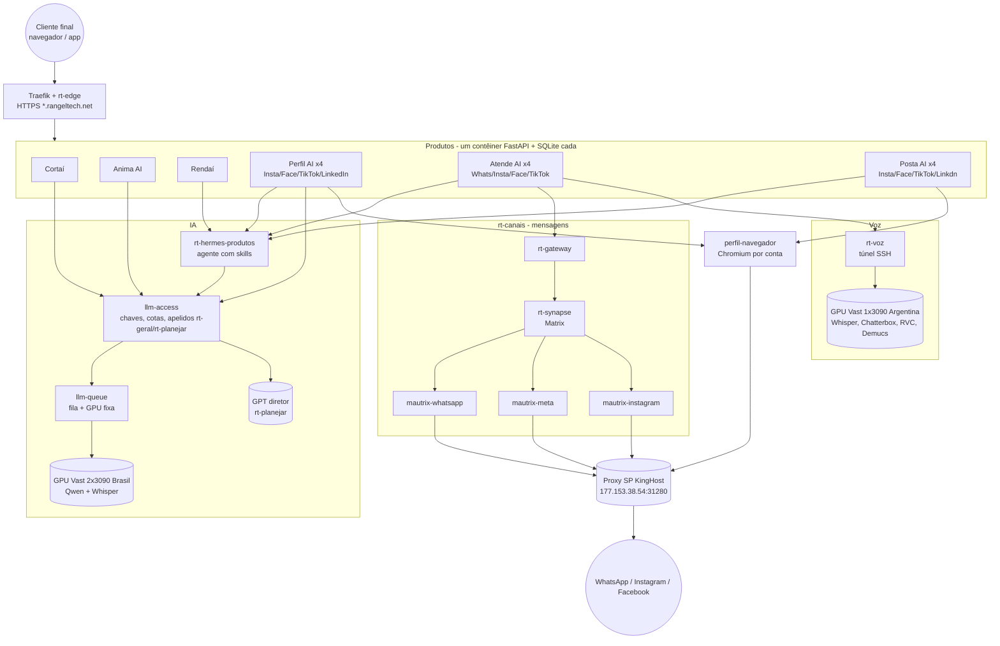

# Arquitetura dos produtos Rangel Tech (VPS Contabo)

Documento de referência dos 16 produtos e da infraestrutura que os sustenta. Escrito para quem vai manter isto daqui a anos:
cada peça diz **o que é, onde está, por que existe e como trocar**. Atualizado em 16/11/2026.

- **VPS**: Contabo `66.94.101.153`, 12 vCPU, 47 GB RAM, 387 GB de disco. Acesso: `ssh -i vps_rt_infra_deploy_v3 deploy@66.94.101.153` (sudo sem senha).
- **Regra de ouro**: só o repositório `RangelTech/vps_rt_infra` implanta. Nada é editado à mão em produção sem voltar para o repositório.
- **Fora de escopo**: LUAR (stacks `canais`, `kernel-harness`, `chatwoot-*`, `rt-hermes-w*`) não é tocado pelos produtos. A VPS da Capital Certo e a VM do Juca não fazem parte desta arquitetura.

## 1. Visão geral

## 2. Produtos

| Produto | Contêiner / stack | Domínios | O que faz | IA |
|---|---|---|---|---|
| Cortaí | `cortai` | cortai.rangeltech.net | corta vídeos longos em clipes verticais com legenda | diretor GPT, Whisper, visão, YuNet (enquadramento) |
| Anima AI | `animaai` | anima-ai.rangeltech.net | ideia em uma frase → animação narrada | diretor GPT, imagens, visão, TTS |
| Rendaí | `rendai` | rendai.rangeltech.net | vitrine de produtos para afiliados, gamificada | Hermes (kits de divulgação) |
| Perfil AI (4) | `perfilai` | insta-ai, face-ai, tittok-ai, linkdn-ai, perfilai | plano de perfil, bios, roteiros, aplicar bio | diretor GPT + Hermes (redator) + visão |
| Atende AI (4) | `atendeai` | atende-whats/insta/face/tiktok | atendimento automático, voz do dono | Hermes + rt-voz |
| Posta AI (4) | `postaai` | posta-insta/face/tiktok/linkdn | agenda e publica posts, lote, planilha | Hermes (legendas) |

Todos usam o mesmo esqueleto: FastAPI, SQLite em `/opt/platform/data/<produto>`, login por e-mail e senha (código por e-mail só no
cadastro e no "esqueci a senha"), assinatura pela Cakto (webhook assinado), página de vendas em `static/index.html`.
A **marca vem do domínio** (um código, vários produtos): `app/marcas.py` em cada repositório.

## 3. Inteligência artificial

- **Hermes dos produtos** (`stacks/rt-hermes-produtos`): Hermes Agent (NousResearch, MIT) na imagem fixada `rt/rt-hermes`, modo
  gateway com servidor de API OpenAI em `http://rt-hermes-produtos:8642/v1` (rede `internal`, chave `HERMES_PRODUTOS_KEY`).
  Só a ferramenta de **skills**; sem terminal, arquivos, navegador ou código. Pensamento do modelo desligado (`reasoning_effort: none`).
  Skills em `stacks/rt-hermes-produtos/skills/` (ex.: `atendente-de-negocio`).
- **llm-access** (`stacks/llm-access`): porta única das chaves; apelidos `rt-geral` (Qwen, com GPT de reserva), `rt-planejar` (GPT diretor),
  `visao`, imagem. Painel e uso no Postgres `llm_access`.
- **llm-queue**: fila e GPU fixa. `GPU_STATIC_INSTANCE_ID` em `/opt/platform/secrets/llm-queue.env`. A fila sobe o vLLM e o STT por SSH.
- **Regra**: toda IA que conversa ou escreve para o cliente passa pelo Hermes. Diretor GPT, imagem, visão e Whisper ficam nos motores
  próprios (o Hermes não oferece esses serviços).

## 4. Mensagens (stack `rt-canais`)

- **Synapse** próprio (`rt-synapse`, server_name `produtos.internal`) e Postgres próprio (`rt-matrix-postgres`).
- **Pontes mautrix**: WhatsApp (QR ou código de pareamento; aparece como Chrome/Windows), Meta (Facebook por usuário e senha,
  fluxo `messenger-lite`), Instagram (`android`, usuário e senha). Fluxos de cookie/webview são recusados de propósito.
- **rt-gateway** (`RangelTech/rt-canais`): API interna `/internal/channels/*` com token. Faz o login passo a passo, entrega webhooks
  assinados (HMAC) aos produtos, envia texto, **nota de voz** (MSC3245) e imagem, e serve a mídia recebida (`/media`).
  Conta de cada produto = `account_id` (Atende: 7.000.000 + usuário). Cada conexão tem o seu usuário Matrix.
- **TikTok**: `tiktok_worker` com ReLttk (subprocesso do gateway).
- **Proxy SP obrigatório**: todo tráfego de rede social sai pelo proxy de São Paulo. Firewall `RT-PROXY-SP` na cadeia `DOCKER-USER`
  (`scripts/proxy-sp/aplicar-firewall.sh`, unidade `rt-proxy-sp.service`) bloqueia saída direta das redes `*_egress` de canais.

## 5. Voz (spec 44, 8.5)

- **rt-voz** (`RangelTech/rt-voz`) roda numa GPU 1x3090 da Vast (hoje Argentina, instância 60859031), só em `127.0.0.1:18010`.
- A VPS chega nele pelo contêiner `rt-voz` (stack `stacks/rt-voz`), um túnel SSH; os produtos chamam `http://rt-voz:18010`.
- Peças (todas com licença comercial): faster-whisper (ouvir), Chatterbox multilingual (falar), RVC v2 via Applio (voz do dono,
  treinada uma vez), Demucs (separar voz para cantar), audfprint (reconhecer música do índice próprio).
- Sem custo por mensagem: o custo é a GPU fixa.

## 6. Redes Docker

| Rede | Quem | Para quê |
|---|---|---|
| `public` | Traefik + produtos | entrada HTTPS |
| `internal` | produtos, llm-*, rt-gateway, perfil-navegador, rt-hermes-produtos, rt-voz | conversa interna (nunca exposta) |
| `rt_canais_net` | Synapse, Postgres Matrix, pontes, gateway | Matrix isolado |
| `rt_canais_egress`, `perfil-navegador_egress` | pontes, navegador | saída para redes sociais, **só pelo proxy SP** |
| `rt_voz_egress`, `rt_hermes_produtos_egress` | túnel de voz, Hermes | saída para a GPU e para o llm-access público |

## 7. Implantação

1. No repositório do produto: workflow `release.yml` (input `version`) gera a imagem e a release.
2. No `vps_rt_infra`: workflow `deploy.yml` (`service`, `version`) grava `releases/<serviço>.lock`, sincroniza `stacks/<serviço>`
   para `/opt/platform/stacks/<serviço>` e sobe com `docker compose --env-file .release.env`.
3. Atalho local: `new_ragente/qa/publicar.sh repo:versao[:servico] ...` faz os dois, um de cada vez.
4. A pasta da stack na VPS precisa ser de `deploy:deploy` (senão o rsync falha).

## 8. Segredos

- Na VPS: `/opt/platform/secrets/<serviço>.env` (600). Gravados pelos workflows `*-segredos.yml` a partir dos secrets do GitHub.
- Cofre pessoal: `personal-skills/secrets/` (cópia local em `~/.claude/secrets/`). Toda credencial nova vai para lá no mesmo dia.
- **Nunca rotacionar credencial** (regra do Lucas): credencial que não entra = achar o erro de leitura primeiro.

## 9. Operação (procedimentos)

- **Trocar a GPU do Qwen**: é automático pelo caça-GPU (`scripts/caca-gpu/README.md`): ele procura, aluga, testa e troca de
  madrugada, e na hora se a fixa cair. À mão: alugar (imagem `ghcr.io/lucasrangelssouza/qwen-vllm:v0.30.0-cu13-slim1`, env
  `CONTAINER_RUNTIME=runc`), baixar o modelo (`hf download twolven/Qwen3.8-27B-abliterated-AWQ-MTP --local-dir /workspace/models/awq`),
  trocar `GPU_STATIC_INSTANCE_ID`, recriar `llm-queue`.
- **Trocar a GPU de voz**: alugar 1x3090, `scripts/instalar.sh` e `scripts/subir.sh` do rt-voz, atualizar `VOZ_SSH_HOST/PORT` em
  `/opt/platform/secrets/rt-voz.env` e recriar a stack `rt-voz`.
- **WhatsApp caiu**: o cliente toca em Reconectar no painel; o gateway recupera sozinho login concluído que não viu.
- **Teste sem risco**: no Atende, "Modo teste" faz a IA responder só conversas liberadas uma a uma.

## 10. Backup

Restic diário no Google Drive (rclone) com `/opt/platform/data` (SQLite dos produtos) e dumps do Postgres. Último sucesso em
`/opt/platform/data/backups/last_ok.json`.
